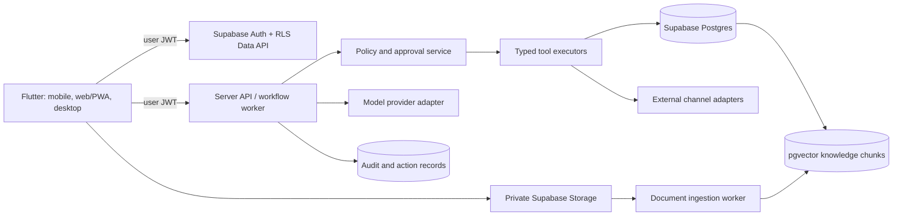

# OG Workforce AI — foundation blueprint

**Status:** design baseline, 24 September 2026. No application, database, provider account, or deployment has been created.

## Product boundary

OG Workforce AI is one organisation scoped operating system with shared knowledge and specialist agents. The first usable release is the **Business Assistant**: a business owner can create a workspace, enter company facts, upload documents, ask grounded questions, and review a complete record of any proposed or executed action. WhatsApp, accounts, tenders, email, and voice join the same platform in later releases.

The Workforce Manager is an internal coordinator, not a billable employee. It may delegate only to installed agents with permitted tools. An agent's access is the intersection of organisation policy, staff role, agent configuration, subscription entitlement, and channel context. A model response never grants permission.

## System architecture



- **Flutter:** one feature based Dart codebase with adaptive navigation and native platform shells. Web is installable as a PWA. Platform specific integrations sit behind interfaces; support for all six targets is an architectural goal and must be validated with builds on their respective toolchains.
- **Supabase:** identity, tenant scoped relational data, private files, and vector retrieval. Publishable client key only. RLS applies to every exposed table; storage policies are scoped to the organisation and document permission.
- **Server API:** Cloudflare Workers is the initial candidate for HTTP endpoints, webhooks, and scheduled triggers. Long document parsing or durable jobs require a queue/worker design and retries; avoid assuming a single request can safely process everything. Provider and integration secrets stay server side.
- **AI layer:** `ModelProvider` and `EmbeddingProvider` interfaces. Groq can be evaluated for initial text inference and Workers AI as a fallback after checking model suitability, data handling, rate limits, and cost. Fallback must never silently change the permission decision. Provider choice is configuration, not a client feature.

## Required trust boundaries

1. The client sends a user token and organisation context; the server verifies membership from the database on each privileged request. Never trust a client supplied organisation ID alone.
2. RLS checks membership and role for reads/writes. Cross organisation foreign keys must be constrained with composite `(organisation_id, id)` references where possible, so a row cannot point to another tenant's customer or document.
3. Every agent tool has a schema, required permission, risk level, idempotency key, and handler. The policy service decides `execute`, `approval_required`, or `deny` before any side effect. The handler rechecks approval and entitlement at execution time.
4. Approval records bind a specific action payload hash, organisation, requester, approver, expiry, and status. A changed payload invalidates approval. Financial transfers, ownership changes, credential disclosure, security disabling, unauthorised permission changes, historical finance deletion, debt write off, and legal proceedings have no agent executor.
5. Documents and retrieved passages are untrusted data. Retrieval filters by organisation, document access, and publication status before relevance ranking. The model receives short sourced passages. It cannot call a tool solely because a document instructs it to.
6. Replies about business facts need a source or verified structured record. If evidence is missing, ask for clarification or escalate; never invent a price. Confidence is supported by retrieval quality and business rules, not just a model self rating.
7. Audit events record the actor, agent, action, decision, input reference, result, and timestamp without storing credentials or unnecessary personal data. Webhooks require signature checks, replay protection, and idempotency.

## Database design and migration order

Every tenant owned row has `organisation_id uuid not null`, `id uuid`, `created_at`, and where relevant `updated_at`, `created_by`, and a lifecycle status. Index `(organisation_id, created_at)` for lists and tenant keyed foreign keys. Use `numeric` plus currency code for money; never floating point. Store timezone on the organisation and UTC timestamps for events. Soft delete only where recovery/audit requires it.

| Migration | Tables and purpose | First release |
|---|---|---|
| 001 identity | `organisations`, `profiles`, `organisation_members`, `roles`, `role_permissions` | Yes |
| 002 knowledge | `business_profiles`, `products`, `services`, `documents`, `document_versions`, `document_chunks` (vector, model/version, source page, classification) | Yes |
| 003 agents | `agent_types` (system catalogue), `agents`, `agent_configs`, `agent_permissions`, `agent_sessions`, `agent_actions`, `agent_memories` | Yes |
| 004 governance | `approvals`, `audit_logs`, `notifications` | Yes |
| 005 billing | `plans`, `plan_entitlements`, `subscriptions`, `usage_events`, `billing_events` | Entitlement model first; charging later |
| 006 CRM | `customers`, `leads`, `conversations`, `messages`, `tasks`, `appointments` | Later |
| 007 channels | `channels`, `integrations` (credential references only), `calls`, `emails` | Later |
| 008 finance | `quotes`, `quote_items`, `invoices`, `invoice_items`, `payments`, `reminders` | Later |
| 009 tenders | `tenders`, `tender_matches`, `tender_requirements`, `tender_applications` | Later |
| 010 automation | `workflows`, `workflow_rules`, `workflow_runs`, `scheduled_jobs` | Later |

`organisation_members` has unique `(organisation_id, user_id)` and an explicit status. Owner transfer is a separate human authenticated administrative operation. `agent_actions` tracks `proposed → approval_pending → approved/rejected → executing → succeeded/failed`, with idempotent transitions. `approvals` never directly executes an arbitrary JSON instruction. `document_chunks` points to a document version so reindexing does not mix old and new text. Agent memory stores bounded, attributed operational context, with retention rules; Business Brain remains the canonical source.

**RLS pattern:** member read access is based on live `organisation_members` data, with narrower policies for sensitive tables. Writes check both the existing and new row's tenant and the member's permission. Private schemas hold internal functions and secret references; no broad service role access is given to Flutter. Test member A, member B, suspended member, and a user in another organisation against every exposed table and storage path. Supabase documents that RLS is needed on exposed tables and that vector retrieval can be built with the `vector` extension. [RLS documentation](https://supabase.com/docs/guides/database/postgres/row-level-security) · [pgvector documentation](https://supabase.com/docs/guides/database/extensions/pgvector)

## Proposed repository layout

```text
og-workforce-ai/
  apps/flutter/
    lib/app/                 # bootstrap, routing, theme, adaptive shell
    lib/core/                # auth, API, errors, logging, permissions
    lib/features/
      onboarding/ business_brain/ documents/ agents/
      approvals/ dashboard/ billing/
    lib/shared/              # reusable widgets and domain types
    test/
  services/api/src/
    auth/ policy/ agents/ tools/ knowledge/ providers/
    workflows/ integrations/ audit/
  supabase/migrations/
  packages/contracts/       # API schemas, tool contracts, event definitions
  docs/                     # architecture decisions, threat model, runbooks
```

Flutter features contain domain models, repositories, application state, and screens. Screens never call model providers or external channel APIs directly. The API exposes versioned contracts; agent types register manifests and tools, so adding an employee does not require redesigning the core runtime.

## First release workflow

1. Owner registers with basic details and creates a workspace.
2. Owner completes Business Brain facts, with each field marked draft or approved. Uploads go to private storage.
3. Ingestion validates file type/size, scans or quarantines as appropriate, extracts text, chunks it, embeds it, and marks the document searchable only after success. Failed documents remain visible with a clear status.
4. Owner installs and configures Business Assistant. Default permissions are minimal; no external communication tool is enabled.
5. User asks a question. API authenticates, retrieves tenant scoped facts and chunks, constructs a sourced answer, and returns citations. Tool calls pass through policy checks and are audited.
6. Dashboard shows document health, recent assistant activity, approval queue, usage, and subscription entitlement.

## Delivery gates

| Gate | Acceptance evidence |
|---|---|
| Foundation | Flutter app launches on available target toolchains; adaptive shell works at phone/tablet/desktop widths; auth and workspace onboarding complete. |
| Tenant isolation | Automated RLS tests prove cross tenant reads/writes, document access, and agent actions fail. |
| Knowledge | Versioned upload, processing state, tenant filtered retrieval, citations, and missing evidence behaviour work. |
| Business Assistant | Can answer from approved facts, create a permitted internal task, request approval for a restricted action, and logs every decision. |
| Release readiness | Provider cost/limits, privacy/retention, backups, monitoring, incident handling, and platform builds reviewed before any live channel or billing integration. |

## Open decisions before implementation

- Confirm the first pilot business, its data classification, and whether South African data residency is required. This affects hosting and provider selection.
- Decide exact staff roles, approval thresholds, document classifications, and retention periods with the pilot.
- Confirm which provider contracts and channels are available. WhatsApp, email, calls, and tender feeds need separate feasibility and commercial checks.
- Treat the listed rand prices as hypotheses. Define included usage, overages, and actual provider costs before selling plans.
